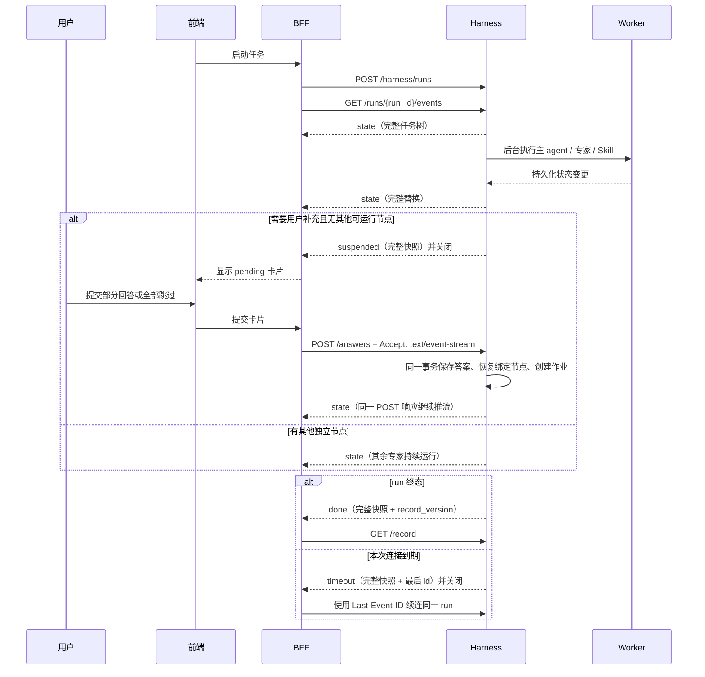

# SSE v3：转发端与前端 cURL 联调手册

本文只验证转发端使用的**单 run 有限 SSE 流**及前端需要呈现的公开状态。不使用会话级持续 SSE 连接。

转发端流程固定为：启动 run → 连接该 run 的事件流 → 收到等待、超时或终态后关闭连接 → 按游标续连或提交回答 → 收到 `done` 后读取 `/record` 并持久化对话记录。

## 1. 公开帧骨架：前端只替换，不推断

V3 的浏览器/BFF 消费模型与 V2 的 `state` 相同：除 `ping` 外，**每一帧 `data` 都是一份完整、可独立渲染的公开 run 快照**。前端不得根据上一帧补丁、工具完成事件或模型文本自行推断任何状态。

```text
event: state
data: {
  "protocol": "hailiang.sse.v3",
  "run_id": "run_xxx",
  "seq": 128,
  "session_id": "session_xxx",
  "profile_id": "profile_xxx",
  "status": "running",
  "outcome": null,
  "reason": "updated",
  "timestamp": "2026-10-19T08:00:00+00:00",
  "snapshot": {
    "protocol": "hailiang.sse.v3",
    "session_id": "session_xxx",
    "profile_id": "profile_xxx",
    "runtime_mode": "harness_v1",
    "cursor": 128,
    "runs": [{
      "id": "run_xxx",
      "status": "running",
      "input_queue": {
        "active_group_id": "input_group_1",
        "queued_group_ids": ["input_group_2"],
        "active_request_id": "input_a",
        "active_group_total": 2,
        "active_group_completed": 0,
        "queued_request_ids": ["input_b"],
        "pending_count": 1,
        "queued_count": 1
      }
    }],
    "nodes": [/* 主任务、专家、Skill、工具 */],
    "input_requests": [/* 卡片及回答状态 */],
    "input_groups": [/* 当前组与后续组 */],
    "messages": [/* 阶段说明与最终正文 */]
  }
}
```

字段用途：

| 字段 | 前端/BFF 用法 |
| --- | --- |
| `seq` | 同一订阅范围的重放游标；仅丢弃小于等于已处理值的重复帧。过滤其他 run 后序号可以不连续。 |
| `status`、`outcome` | 当前 run 的权威执行状态与业务结果。`outcome=partial` 不是技术失败。 |
| `reason` | `updated`、`waiting_for_user`、`forwarder_wait_limit`、`completed` 或 `resync_required`。 |
| `snapshot` | 当前 run 可显示的全部状态；接收到有效帧后整体替换本地 run 气泡。 |
| `snapshot.nodes` | 只用于展示任务树。工具 `completed` 不表示所属专家已完成。 |
| `snapshot.runs[0].input_queue` | 队列摘要。`active_group_id`、`queued_group_ids` 决定组顺序；`active_request_id` 是当前唯一可填写卡片。 |
| `snapshot.input_groups` | 稳定的问题组实体：`active`、`queued`、`completed`，含题数、完成数、当前题和专家摘要。 |
| `snapshot.input_requests` | 单题字段、归属和绑定。只有活动组的 `active_request_id` 为 `pending` 且可填写；同组其余题和后续组均为 `queued`。 |
| `snapshot.messages` | 始终使用 final 消息的完整 `content`；不再拼接 token 或正文增量。 |

对外事件只有：

| SSE 事件 | 何时发出 | 帧后的连接行为 |
| --- | --- | --- |
| `state` | run 创建、任务/工具/卡片/正文/结果任一公开状态变更后 | 保持连接。 |
| `suspended` | 已先发出等待用户的完整 `state`，且当前没有独立节点可继续 | 服务端关闭本次流，等待用户操作。 |
| `timeout` | 本次有限流接近 BFF 的五分钟等待上限，run 仍未终态 | 服务端关闭本次流；任务继续后台执行。 |
| `done` | run、节点、卡片及最终正文都已投影并持久化后 | 服务端关闭本次流；这是唯一的可落库终态信号。 |
| `ping` | 无业务状态变化时保活 | 忽略。 |

`node.updated`、`message.delta`、`run.finalized` 是内部 outbox/诊断事件，**不再是 BFF 或前端协议**。

## 2. 前后依赖与主动恢复

### 2.1 先接收问题，再拆分；追问属于子任务队列

一次 run 的业务顺序是：

```text
用户问题 + 当前档案/会话事实 + 必要近期原话
  → 主 agent 规划：明确目标、约束、完成条件
  → delegate_tasks：创建不同专家的 TaskBrief 和依赖图
  → 专家并行：各自只读取任务书、相关事实和自己授权的 Skill
  → 专家提交结构化结果
  → 主 agent 只汇总专家结果与必要证据，生成最终正文
```

主 agent 不把完整对话、其他专家轨迹或专家内部 Skill 输出复制给子 agent。每个专家只收到自己的 `TaskBrief`、所需事实投影、尚未解决的绑定追问与必要依赖结果。这样专家 A 的追问不会污染专家 B 的上下文，也不会阻塞 B 的独立分析。

追问的队列规则是会话范围内**同时最多一张 `pending` 卡片**，并按持久化问题组推进：首题立即建立单题活动组；活动组存在期间到达的新问题进入同一个后续 queued 组；该组被激活后，新问题只能进入再下一组，不能插入当前组。

| 时刻 | 专家 A | 专家 B | 卡片与 run 行为 |
| --- | --- | --- | --- |
| A 首先缺信息 | `waiting_for_user` | 仍可 `running` | A 的卡片为 `pending`，B 继续。run 保持 `running`。 |
| B/C 随后也缺信息 | `waiting_for_user` | `waiting_for_user` | B、C 进入同一个 queued 组；前端仅显示该组的题数和专家摘要。 |
| 用户回答/跳过 A | A 的绑定工具完成并重新入队 | B/C 仍等待 | 服务端原子激活下一组，先仅提升 B 为 `pending`；B 提交后才显示 C。答案 POST 的 SSE 立即发出新的完整 `state`。 |
| A/B 都无独立工作可做 | 等待答案 | 等待答案 | `state` 显示 pending/queued；只有此时流才以 `suspended` 收束。 |
| 用户回答 B | B 继续或形成 partial 结果 | 其他可运行节点继续 | 不创建新 run；继续同一个任务树，最终交给主 agent 汇总。 |

`queued` 不是失败、也不是“模型没有追问”；它表示问题已经持久化、归属到对应专家及其工具，但为了避免多个专家同时打断用户，尚未提升为唯一可填写的 `pending` 卡片。用户不能提交 `queued` 卡片，前端也不能自己提升它。相同用户、事实字段、对象和适用时间，且输入约束兼容的追问复用同一张卡片和绑定；用户一次回答或跳过会同时恢复所有绑定专家，不再重复提问。



依赖规则：

1. 状态与 SSE 帧在同一数据库事务写入；帧中的 `snapshot` 是该次变更后的事实，不临时拼装最新状态。
2. 用户回答只恢复该卡片绑定的节点；其他专家若仍可运行会持续工作，不因一个专家等待而暂停。
3. `suspended` 只在没有独立节点可继续时出现。用户提交时不需要额外“恢复”接口：答案 POST 的 SSE 响应就是主动恢复流。
4. `timeout` 不改变任何 run/node/input 状态；它只是传输边界。BFF 或浏览器 EventSource 用最后一个 SSE `id` 自动续连相同 URL，不能重新启动 run。
5. `done` 只在所有公开终态已经写入后发送；BFF 以 `run_id + record_version` 幂等保存对话记录。

## 3. 启动与变量

```bash
export HAILIANG_SSE_V3=true
export VITE_HAILIANG_SSE_V3=true
# 转发端最长等待五分钟；服务端主动在 290 秒关闭，留出网络余量。
export HAILIANG_SSE_V3_RUN_STREAM_SECONDS=290
./run.sh
```

另开终端：

```bash
export BASE="http://127.0.0.1:8010" # 以 run.sh 日志为准
export SESSION_ID="session-sse-v3-$(date +%s)"
export USER_ID="user-sse-v3-curl-001"
export PROFILE_ID="profile-sse-v3-curl-001"
export STUDENT_NAME="小海"
```

以下命令依赖 `curl`、`jq`。每个完整场景使用新的 `SESSION_ID`，避免旧任务影响结果。

## 4. 转发端能力检查

```bash
curl -sS "$BASE/api/v3/sessions/$SESSION_ID/harness/capabilities" | jq
```

确认 `protocols` 包含 `hailiang.sse.v3`，且 `finite_run_stream` 为 `true`。`404 SSE_V3_DISABLED` 表示后端启动时未读到 `HAILIANG_SSE_V3=true`。

## 5. 场景：启动任务并观察前端任务树

转发端向算法服务启动 run：

```bash
export START_SUBMISSION_ID="start-001"

curl -sS -X POST \
  -H "Content-Type: application/json" \
  "$BASE/api/v3/sessions/$SESSION_ID/harness/runs" \
  -d "{
    \"submission_id\": \"$START_SUBMISSION_ID\",
    \"goal\": \"请让合适的多个专家并行分析孩子的升学方向和兴趣发展。如果缺少省份或兴趣信息，必须通过追问工具向我提问，不要自行假设。\",
    \"context_data\": {
      \"user_id\": \"$USER_ID\",
      \"profile_id\": \"$PROFILE_ID\",
      \"student_name\": \"$STUDENT_NAME\"
    }
  }" | tee /tmp/sse-v3-start.json | jq

export RUN_ID="$(jq -r '.run_id' /tmp/sse-v3-start.json)"
echo "$RUN_ID"
```

预期为 `202`，响应包含 `run_id`、`status=running`。前端随后连接**该 run**：

```bash
curl --no-buffer -sS \
  -H "Accept: text/event-stream" \
  "$BASE/api/v3/sessions/$SESSION_ID/harness/runs/$RUN_ID/events?user_id=$USER_ID&profile_id=$PROFILE_ID" \
  | tee /tmp/sse-v3-$RUN_ID.log
```

第一帧是 `state`；每一帧 `state` 都带完整公开状态骨架，前端直接整体替换当前 run 的状态。前端应展示“主任务 → 专家 → Skill／工具”的树，不展示内部提示词或原始工具参数。

连接只会在下列控制事件后关闭：

| 最后一帧 | 转发端动作 | 前端动作 |
| --- | --- | --- |
| `suspended` | 结束本次转发；等待用户卡片 POST | 显示该专家的待答卡片 |
| `timeout` | 使用最后 SSE `id` 自动续连同一 run | 保持当前任务状态，不能标失败 |
| `done` | GET `/record` 并按 `run_id + record_version` 持久化 | 显示终态正文及执行结果 |

## 6. 场景：状态快照与任务树核验

前端首屏、恢复失败或发现版本异常时获取快照：

```bash
curl -sS \
  "$BASE/api/v3/sessions/$SESSION_ID/harness?user_id=$USER_ID&profile_id=$PROFILE_ID" \
  | tee /tmp/sse-v3-snapshot.json | jq
```

核验 run：

```bash
jq --arg run "$RUN_ID" '.runs[] | select(.id == $run) | {
  id, status, outcome, allowed_actions,
  completed_count, task_count, waiting_count, elapsed_ms
}' /tmp/sse-v3-snapshot.json
```

核验前端任务气泡中的节点：

```bash
jq --arg run "$RUN_ID" '.nodes[] | select(.run_id == $run) | {
  id, parent_id, kind, actor, title, status, outcome, attempts, error
}' /tmp/sse-v3-snapshot.json
```

`tool` 完成不等于专家完成；前端只能显示后端投影出的 `status`、`outcome` 和 `error`，不能自行推进节点。

## 7. 场景：专家追问、部分填写与恢复

等待有限流以 `suspended` 结束，或从快照找当前卡片：

```bash
curl -sS \
  "$BASE/api/v3/sessions/$SESSION_ID/harness?user_id=$USER_ID&profile_id=$PROFILE_ID" \
  > /tmp/sse-v3-snapshot.json

jq --arg run "$RUN_ID" '.input_requests[] | select(.run_id == $run) | {
  id, actor, round, status, request_version, fields, answer
}' /tmp/sse-v3-snapshot.json

export REQUEST_ID="$(jq -r --arg run "$RUN_ID" '.input_requests[] | select(.run_id == $run and .status == "pending") | .id' /tmp/sse-v3-snapshot.json | head -n 1)"
export REQUEST_VERSION="$(jq -r --arg id "$REQUEST_ID" '.input_requests[] | select(.id == $id) | .request_version' /tmp/sse-v3-snapshot.json)"
```

只填写省份，空白字段由服务端记录为 `skipped_fields`。表单提交请求同时携带 `Accept: text/event-stream`，该请求会直接变成后续任务流；前端不需要提交后重新 GET 或手工续连：

```bash
curl --no-buffer -sS -X POST \
  -H "Content-Type: application/json" \
  -H "Accept: text/event-stream" \
  "$BASE/api/v3/sessions/$SESSION_ID/input-requests/$REQUEST_ID/answers" \
  -d "{
    \"user_id\": \"$USER_ID\",
    \"profile_id\": \"$PROFILE_ID\",
    \"submission_id\": \"answer-partial-001\",
    \"expected_version\": $REQUEST_VERSION,
    \"answers\": {\"province\": \"浙江\"},
    \"skipped\": false
  }" | jq
```

前端预期：该卡片变 `answered`，显示填写项及跳过字段；只恢复它绑定的专家/Skill 节点，其他专家继续维持自己的状态。字段名须与 `fields[].key` 一致。

提交请求本身会继续推送有限 SSE 流。转发端应逐帧转发这一个响应，直到收到 `suspended`、`timeout` 或 `done`；不要在成功提交后额外调用恢复接口。若这段流以 `timeout` 收束，才使用最后收到的 SSE `id`（也就是帧的 `seq`）续连同一 run。

## 8. 场景：全部跳过与旧卡片拒绝

对待答卡片全部跳过：

```bash
curl --no-buffer -sS -X POST \
  -H "Content-Type: application/json" \
  -H "Accept: text/event-stream" \
  "$BASE/api/v3/sessions/$SESSION_ID/input-requests/$REQUEST_ID/answers" \
  -d "{
    \"user_id\": \"$USER_ID\",
    \"profile_id\": \"$PROFILE_ID\",
    \"submission_id\": \"answer-skip-001\",
    \"expected_version\": $REQUEST_VERSION,
    \"answers\": {},
    \"skipped\": true
  }" | jq
```

预期卡片为 `skipped`，绑定节点恢复后可形成 `partial` 结论。重复用旧版本提交应为 `409`：

```bash
curl -sS -i -X POST \
  -H "Content-Type: application/json" \
  "$BASE/api/v3/sessions/$SESSION_ID/input-requests/$REQUEST_ID/answers" \
  -d "{\"user_id\":\"$USER_ID\",\"profile_id\":\"$PROFILE_ID\",\"submission_id\":\"answer-stale-001\",\"expected_version\":$REQUEST_VERSION,\"answers\":{},\"skipped\":true}"
```

前端收到拒绝时重新拉快照，不能用旧卡片再次推进任务。

## 9. 场景：五分钟超时与断线续传

为了快速测试，启动服务前临时配置：

```bash
export HAILIANG_SSE_V3_RUN_STREAM_SECONDS=10
```

有限流最后应收到：

```text
event: timeout
```

取游标并重新连接同一 run：

```bash
export RESUME_AFTER="$(sed -n 's/^id: //p' /tmp/sse-v3-$RUN_ID.log | tail -n 1)"

curl --no-buffer -sS \
  -H "Accept: text/event-stream" \
  -H "Last-Event-ID: $RESUME_AFTER" \
  "$BASE/api/v3/sessions/$SESSION_ID/harness/runs/$RUN_ID/events?user_id=$USER_ID&profile_id=$PROFILE_ID&after=$RESUME_AFTER" \
  | tee /tmp/sse-v3-$RUN_ID-resume-timeout.log
```

`seq` 是会话范围游标；过滤其他 run 后不要求相邻。前端只需丢弃小于等于已处理游标的重复帧；每个有效帧整体替换状态，不能把 `timeout` 显示为失败。

## 10. 场景：最终正文、完成与对话记录落库

有限流结束时，检查公开帧顺序和最终快照：

```bash
grep -E '^(id:|event:|data:)' /tmp/sse-v3-$RUN_ID*.log
```

前端处理正文规则：从每帧 `snapshot.messages` 读取完整正文并整体替换，不再拼接 token 增量或校验 offset。最后应看到 final 消息的 `status=completed` 或 `interrupted`，以及 `done`。

收到 `done` 后，转发端读取不可变记录：

```bash
curl -sS \
  "$BASE/api/v3/sessions/$SESSION_ID/harness/runs/$RUN_ID/record?user_id=$USER_ID&profile_id=$PROFILE_ID" \
  | tee /tmp/sse-v3-record-$RUN_ID.json | jq '{
    run_id, record_version, user_message, assistant_message,
    execution, agent_summary, input_summary
  }'
```

转发端以 `run_id + record_version` 为幂等键持久化该记录。前端刷新历史时由转发端读取此记录，不重放专家内部轨迹。

## 11. 场景：新消息中止旧任务并启动新任务

启动一个较长的旧任务后，立即发新任务：

```bash
curl -sS -X POST -H "Content-Type: application/json" \
  "$BASE/api/v3/sessions/$SESSION_ID/harness/runs" \
  -d "{\"submission_id\":\"interrupt-old-001\",\"goal\":\"请让多个专家详细分析多个升学方案，分别检索资料后再汇总。\",\"context_data\":{\"user_id\":\"$USER_ID\",\"profile_id\":\"$PROFILE_ID\",\"student_name\":\"$STUDENT_NAME\"}}" \
  | tee /tmp/sse-v3-old.json | jq
export OLD_RUN_ID="$(jq -r '.run_id' /tmp/sse-v3-old.json)"

curl -sS -X POST -H "Content-Type: application/json" \
  "$BASE/api/v3/sessions/$SESSION_ID/harness/runs" \
  -d "{\"submission_id\":\"interrupt-new-001\",\"goal\":\"先不用分析升学方案了，请只回答：如何和孩子沟通兴趣选择？\",\"context_data\":{\"user_id\":\"$USER_ID\",\"profile_id\":\"$PROFILE_ID\",\"student_name\":\"$STUDENT_NAME\"}}" \
  | tee /tmp/sse-v3-new.json | jq
```

新响应包含 `superseded_run_id`。前端检查旧 run 为 `cancelled`，`cancellation_reason= superseded_by_new_run`；旧正文若已发布为 `interrupted`。旧 run 的中间工具结果、专家分析和草稿不能作为新 run 上下文，也不能写入新一轮历史记录。

## 12. 场景：主动取消

```bash
curl -sS -X POST -H "Content-Type: application/json" \
  "$BASE/api/v3/sessions/$SESSION_ID/harness/runs/$RUN_ID/cancel" \
  -d "{\"user_id\":\"$USER_ID\",\"profile_id\":\"$PROFILE_ID\"}" | jq
```

预期 run 为 `cancelled`，待答卡片为 `expired`，已发布正文为 `interrupted`，该 run 的有限流最终收到 `done`。重复取消不得重新激活任务。

## 13. 场景：模拟 BFF 转发

启动参考 BFF：

```bash
export BFF_UPSTREAM="$BASE"
export BFF_DEMO_COOKIE="local-only"
export BFF_DEMO_USER="$USER_ID"
export BFF_DEMO_PROFILE="$PROFILE_ID"
PYTHONPATH=. .venv/bin/uvicorn examples.sse_v3.bff:app --host 127.0.0.1 --port 8090
```

浏览器通过 BFF 订阅有限流（身份由 Cookie 注入，浏览器参数不会被信任）：

```bash
curl --no-buffer -sS \
  -H "Cookie: demo_session=local-only" \
  -H "Accept: text/event-stream" \
  "http://127.0.0.1:8090/api/v3/sessions/$SESSION_ID/harness/runs/$RUN_ID/events"
```

BFF 必须原样转发 SSE：不得缓冲、重排、改写正文、遇到 `timeout` 自动重复启动 run，或因浏览器连接关闭调用取消接口。

## 14. 验收记录

| 场景 | 关键事件 | 前端结果 | 转发端结果 |
| --- | --- | --- | --- |
| 启动与分派 | `state` | 更新任务树 | 仅订阅该 run |
| 多专家追问 | `suspended` | 显示带专家名的卡片 | 保存游标后关闭 |
| 部分回答 | `state` | 显示已答／跳过字段 | 提交后按游标续连 |
| 全部跳过 | `state` | 卡片变 skipped | 不重复提交旧卡片 |
| 超时 | `timeout` | 保持进行中 | 续连同一 run |
| 正文完成 | `state` | 连续渲染正文 | 等待 `done` |
| 终态落库 | `done` | 显示最终状态 | GET `/record` 幂等落库 |
| 新问题替代 | `done`（旧） | 旧气泡 interrupted | 启动新 run，不传旧中间态 |
| 主动取消 | `done` | cancelled／expired | 不再续连旧 run |
